<h1 align="center" style="font-weight: bold;">DoOS - FrontEnd</h1>

  
  
  
  
  

 <a href="#sobre">Sobre</a> • 
 <a href="#rotas">Rotas</a> • 
 <a href="#eu">Sobre mim</a> 

    

<h2 id="sobre">📌 Sobre</h2>

O DoOS é um sistema desenvolvido para facilitar e modernizar o gerenciamento de Ordens de Serviço (OS) em oficinas mecânicas.
Nosso objetivo é oferecer uma plataforma intuitiva, rápida e efetiva para lidar com clientes, veículos, serviços, peças, mecânicos e principalmente a ordem de serviço; desde a chegada do veículo na oficina, até o fim do serviço.  
**Nota:** Esse repositório comporta apenas o frontend do projeto (parte da qual fiquei responsável inteiramente), o repositório do backend está disponível no perfil do meu amigo Thales Carrion: [Backend](https://github.com/thalesmanoel/doos-server)

VÍDEO EXPLICATIVO DO FLUXO PRINCIPAL DO PROJETO: [AQUI](https://drive.google.com/file/d/1yWFb_08ZquMrRM_9NZnMHUhY7pLv4Yrt/view)

<h2 id="rotas">📍 Rotas</h2>

| Rota                  | Descrição                                                                                  |
|-----------------------|--------------------------------------------------------------------------------------------|
| <kbd>/dashboard</kbd> | Página inicial com indicadores financeiros e estatísticos sobre a atividade da oficina     |
| <kbd>/produtos</kbd>  | Mostra todos os produtos cadastrados em tabela e permite um CRUD completo desses registros |
| <kbd>/serviços</kbd>  | Mostra todos os serviços cadastrados em tabela e permite um CRUD completo desses registros |
| <kbd>/ordem-de-serviço</kbd>| Mostra todas as ordens de serviço cadastradas em tabela e permite um CRUD completo desses registros |
| <kbd>/criar-de-serviço</kbd>| Tela de cadastrar ordem de serviço completa, além da edição, quando a rota é acessada pelo botão de edição|
| <kbd>/solicitações</kbd> | Mostra todas as solicitações cadastradas em tabela e permite um CRUD completo desses registros |
| <kbd>/mecânicos</kbd>    | Mostra todos os mecânicos cadastrados em tabela e permite um CRUD completo desses registros |
| <kbd>/veículos</kbd>     | Mostra todos os veículos cadastrados em tabela e permite um CRUD completo desses registros |
| <kbd>/clientes</kbd>     | Mostra todos os clientes cadastrados em tabela e permite um CRUD completo desses registros |
| <kbd>/fornecedores</kbd> | Mostra todos os fornecedores cadastrados em tabela e permite um CRUD completo desses registros |

<h2 id="eu">🧑‍💻 Sobre mim</h2>

Caso queira conhecer mais sobre mim, segue abaixo:

<h4>Segue abaixo o Readme do meu perfil no GitHub, para que possa me conhecer melhor 😁.</h4>

